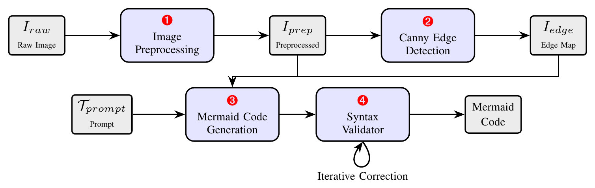

# Dataset and result: EdgeFlow: Edge-Map Augmented VLM-Based Flowchart Processing for Industrial Requirements Engineering

This repository contains the replication package for the paper:

> **EdgeFlow: Edge-Map Augmented VLM-Based Flowchart Processing for Industrial Requirements Engineering**
> Zhifei Dou, Shabnam Hassani, Ou Wei
> 2026 IEEE 34th International Requirements Engineering Conference Workshops (REW), pages 74-83. [Paper (DOI)](https://doi.org/10.1109/rew72749.2026.00021) · [arXiv](https://arxiv.org/abs/2605.27332)

## Overview



Fig. 3 from the paper: overview of the four-step approach (image preprocessing, Canny edge detection, VLM-based Mermaid generation, and syntax validation).

## Contents

- `FlowVQA_Dataset/Images/` - 40 sampled FlowVQA flowchart images used for cross-dataset evaluation (RQ3)
- `FlowVQA_Dataset/Ground_truth/` - Ground-truth Mermaid code for each image
- `FlowVQA_Result_Qwen3/` - Per-run evaluation results for Qwen3-VL-32B-Instruct (5 runs, baseline + EdgeFlow) on sampled FlowVQA
- `FlowVQA_Result_Qwen3.5/` - Per-run evaluation results for Qwen3.5-35B-A3B (5 runs, baseline + EdgeFlow) on sampled FlowVQA

Each `.xlsx` file contains one experimental run. Rows with batch names prefixed `batch_baseline_run_` are the baseline condition; rows prefixed `batch_canny_run_` are the EdgeFlow condition.

IndusReqFlow results (RQ1, RQ2) are not included due to the proprietary nature of Huawei's internal requirements documents.

## Citation

```bibtex
@inproceedings{dou2026edgeflow,
  title     = {EdgeFlow: Edge-Map Augmented VLM-Based Flowchart Processing for Industrial Requirements Engineering},
  author    = {Dou, Zhifei and Hassani, Shabnam and Wei, Ou},
  booktitle = {2026 IEEE 34th International Requirements Engineering Conference Workshops (REW)},
  pages     = {74--83},
  year      = {2026},
  month     = {August},
  publisher = {IEEE},
  doi       = {10.1109/rew72749.2026.00021}
}
```
